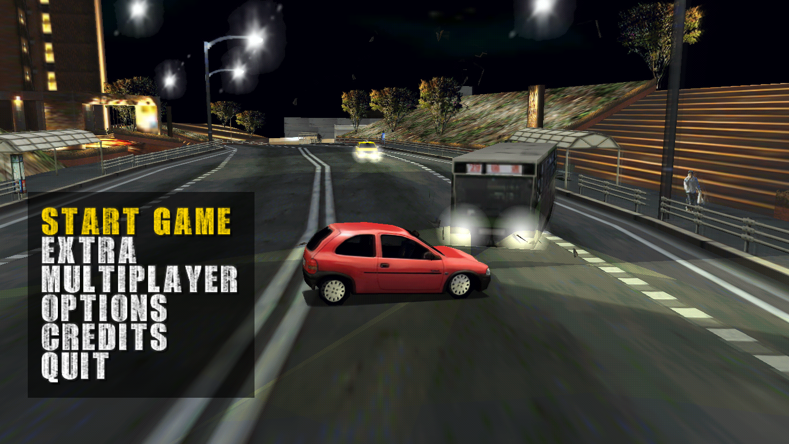
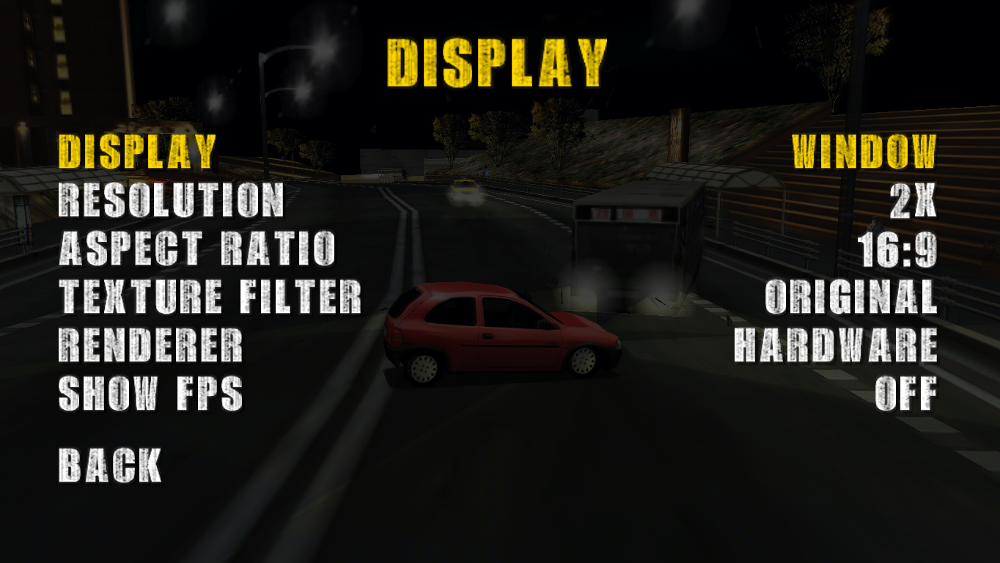
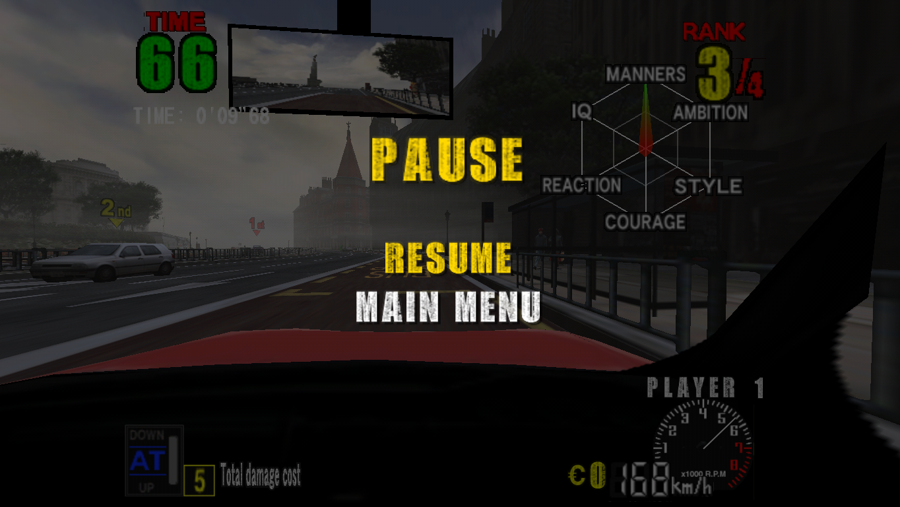
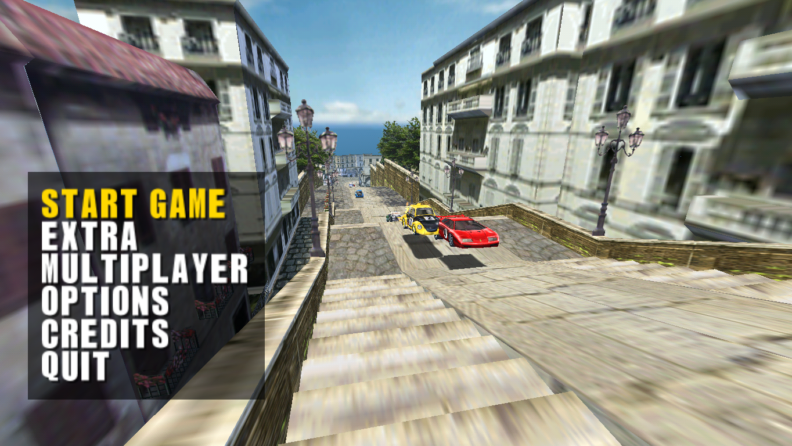
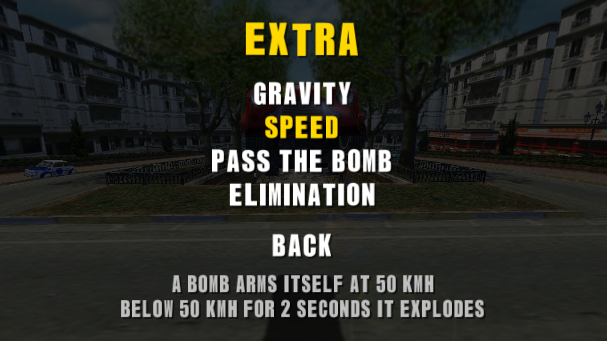
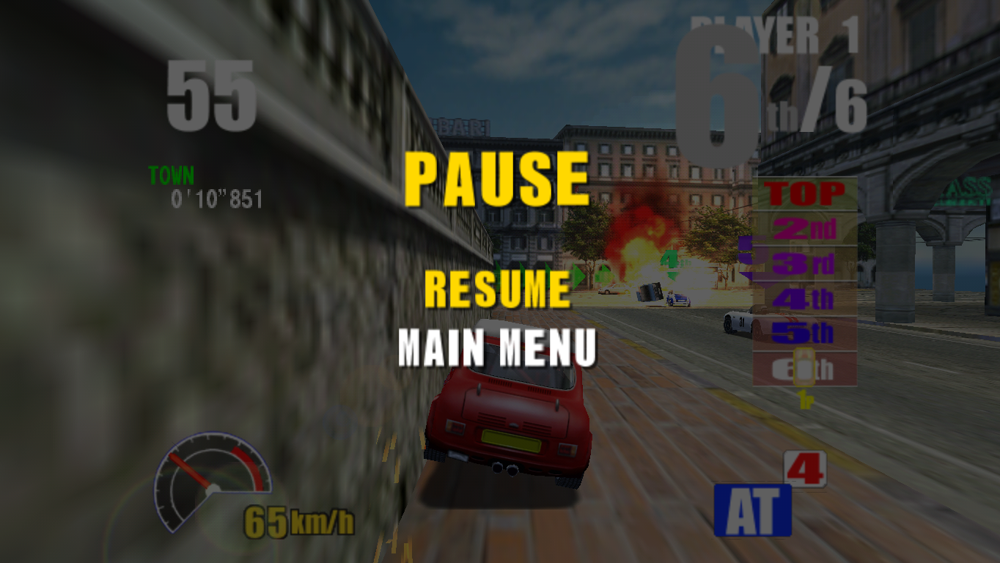

# Konami Viper — static recompilation

Native PC ports of Konami's **Viper** arcade games: **Thrill Drive 2** and **GTI Club 2**
(_GTI Club: Corso Italiano_ / _Driving Party: Racing in Italy_).

The original PowerPC code is **statically recompiled** into C, so the game runs as native code
on your machine. A small shared runtime reimplements the arcade board: Voodoo3 graphics, sound,
I/O, CF card and timekeeper. This is not an emulator.

> **No game files are included.** You build the ports from your own dumps of the game and of
> the board BIOS (see [Required files](#required-files)).

## Download and play

The [releases](https://github.com/spita90/konami-viper-recomp/releases/latest) have packages for
**Windows x86-64**, **Linux x86-64** and **macOS on Apple Silicon**, with nothing else to
install. They hold no game code: they build the ports on your computer from your own dumps, in
about a minute, the first time only.

1. Extract the package and copy your files into its `roms/` folder, in any layout: loose files
   or MAME's zips, and the CHD folders.
2. Run the setup, which checks your files and builds every game it can:
   - **Windows:** double-click `viper-setup.exe`. It is not signed, so Windows may show "Windows
     protected your PC": "More info", then "Run anyway".
   - **Linux and macOS:** open a terminal in the package's folder (where `viper-setup` is) and
     run `./viper-setup` (or `./viper-setup --roms /path/to/your/roms`). On macOS, once before:
     `xattr -dr com.apple.quarantine .` (the package is not signed by Apple, and macOS blocks
     its programs until then).
3. Play: `td2.exe`, `gticlub2.exe`, ... on Windows (a double-click is enough), `./td2`,
   `./gticlub2`, ... on Linux and macOS. After an update, or on another computer, run the setup
   again.

You can also [build from the sources](#build-from-the-sources).

## Two ways to play

### Enhanced: like a PC game

```sh
./td2
```

The default, also when you double-click the executable. Menus, options and pause instead of
coins and operator menus: 2X resolution, widescreen up to 21:9, graphics drawn by the GPU,
course difficulty, language, [extra modes](#extra-modes) with new rules, and
[multiplayer](#multiplayer) over the Internet.

<p align="center">
  
  
  
  <br>
  
  
  
</p>
<p align="center"><sub>Thrill Drive 2 (top) and GTI Club 2 (bottom) in enhanced mode, 2X resolution, 16:9.</sub></p>

### Classic: the arcade cabinet

```sh
./td2 --classic
```

The game as on the original cabinet: insert coins and press START; the original attract mode,
rankings and TEST MODE; 30 fps and the original sound.

<p align="center">
  
  
</p>

On first launch the game calibrates the steering wheel and pedals by itself, as an operator
would, in a few seconds. The two modes keep separate saves. The options, the comparison of the
two modes and the saves are described in the [guide](docs/GUIDE.md).

## Games

| Game                                      | Version      | MAME set     | Executable     | Status          |
| ----------------------------------------- | ------------ | ------------ | -------------- | --------------- |
| **Thrill Drive 2** (2001)                 | EBB (Europe) | `thrild2`    | `./td2`        | Playable        |
| Thrill Drive 2                            | JAA (Japan)  | `thrild2j`   | `./td2j`       | Boots and races |
| Thrill Drive 2                            | AAA (Asia)   | `thrild2a`   | `./td2a`       | Boots and races |
| **GTI Club: Corso Italiano** (2000)       | JAB (Japan)  | `gticlub2`   | `./gticlub2`   | Playable        |
| **Driving Party: Racing in Italy** (2000) | EAA (Europe) | `gticlub2ea` | `./gticlub2ea` | Boots and races |

"Boots and races" means tested with scripted inputs but not yet played by hand. Notes on each
version are in the [guide](docs/GUIDE.md#game-notes).

## Required files

The MAME sets: the Viper BIOS `kviper` plus the games you want.

```
kviper/        941b01.u25, ds2430.u3             Viper BIOS, shared by every game
thrild2/       a41b02.chd, a41ebb_nvram.u39      Thrill Drive 2 (ver EBB)
thrild2j/      a41a02.chd, a41jaa_nvram.u39      Thrill Drive 2 (ver JAA)
thrild2a/      a41a02.chd, a41aaa_nvram.u39      Thrill Drive 2 (ver AAA)
gticlub2/      941b02.chd, 941jab_nvram.u39      GTI Club: Corso Italiano (ver JAB)
gticlub2ea/    941a02.chd, 941eaa_nvram.u39      Driving Party: Racing in Italy (ver EAA)
```

The files are checked by their SHA1 before the build; the list is in the
[guide](docs/GUIDE.md#required-files-and-their-sha1).

## Controls

| Action                                                 | Keyboard                                      | Gamepad              |
| ------------------------------------------------------ | --------------------------------------------- | -------------------- |
| Steer                                                  | ← / → or A / D                                | Left stick           |
| Accelerator                                            | ↑ or W                                        | R2 (or A)            |
| Brake                                                  | ↓ or S                                        | L2 (or B)            |
| Handbrake (GTI Club 2 JAB, Thrill Drive 2 JAA and AAA) | Space                                         | X                    |
| Shift up / down                                        | E / Q                                         | R1 / L1              |
| Start                                                  | 1                                             | Start                |
| Change view (in a race, as on the cabinet)             | 1 (Start)                                     | Start                |
| Menus (enhanced)                                       | Arrows or WASD, Enter or 1, Backspace         | D-pad, A or Start, B |
| Pause (enhanced)                                       | Esc                                           | Guide                |
| Ranking name (enhanced)                                | Type it; Backspace, Enter ends; ← / → browse  | D-pad ← / →, then R2 |
| Insert coin (classic)                                  | 5                                             | Back                 |
| Test / Service (classic)                               | F2 / 9                                        | —                    |
| Fullscreen                                             | F11                                           | —                    |
| Quit                                                   | Esc (enhanced: Esc in the main menu, or QUIT) | Guide, as Esc        |

## Extra modes

EXTRA in the main menu (enhanced mode) starts a race with different rules, in every version:

| Mode          | Game          | Rules                                                                                                  |
| ------------- | ------------- | ------------------------------------------------------------------------------------------------------ |
| Gravity       | GTI Club 2    | Every 10 seconds the gravity turns light or heavy (0.1 to 4 G), with moments at zero G where the cars float off the road. |
| Speed         | Both          | A bomb arms itself at 50 km/h (30 mph) and goes off after 2 seconds below it. In Thrill Drive 2 you drive the bus. |
| Pass the bomb | GTI Club 2    | A car carries a bomb: touch another car to pass it on. When it explodes, that car burns and stops for 4 seconds. |
| Elimination   | GTI Club 2    | Every 45 seconds the last car is out. The goal is only a checkpoint until one car is left; the winner goes on to the next course. |
| Police        | Thrill Drive 2 | You drive the police car and the CPU cars are on the run: stay right on one for 3 seconds to arrest it. |

More in the [guide](docs/GUIDE.md#enhanced-mode).

## Multiplayer

Up to four players race together over the Internet, as linked cabinets did (enhanced mode).

- **Host:** MULTIPLAYER → HOST A GAME, then send the 7-character **session code** to the others.
- **Join:** MULTIPLAYER → JOIN A GAME, then type or paste the code.

No server and nothing to install: the host's game opens its port on the router by itself. If
the router does not allow it, the lobby says so: open UDP port 24700 by hand to host. More in
the [guide](docs/GUIDE.md#enhanced-mode).

## Build from the sources

On macOS and Linux. On Windows, use the package.

1. **Install the tools:** a C/C++ compiler, `make`, Python 3 and SDL2.
   - macOS, with [Homebrew](https://brew.sh) and Xcode's command-line tools: `brew install sdl2`
   - Debian/Ubuntu: `sudo apt install build-essential python3 libsdl2-dev`
2. **Add your files:** the BIOS into `roms/kviper/`, each game into the folder of its MAME set,
   for example `roms/thrild2/`. Each folder has a `README.txt` with the files it expects.
3. **Build** (extract, recompile and compile, about a minute):

   ```sh
   make -j8 game GAME=thrild2
   ```

   This makes `./td2`, the executable named in the [Games](#games) table.

The separate steps, several games side by side and cleaning up are in the
[guide](docs/GUIDE.md#build-in-detail).

## Documentation

- [docs/GUIDE.md](docs/GUIDE.md): the enhanced mode's options, saves and command-line options,
  notes on each version, the files and their SHA1, the build in detail, the repository layout.
- [docs/ARCHITECTURE.md](docs/ARCHITECTURE.md): boot chain, file formats, recompiler and runtime
  design, reverse-engineering notes.
- [CHANGELOG.md](CHANGELOG.md): the changes between versions.

## Legal

- This is an unofficial, non-commercial fan project for preservation and research. It is not
  affiliated with, endorsed by, or sponsored by Konami.
- "Konami", "Thrill Drive", "GTI Club" and "Driving Party" are trademarks of Konami Group
  Corporation. All other trademarks belong to their owners.
- This repository contains **no copyrighted game code, ROM, BIOS, CHD or NVRAM data**. The build
  extracts the game from files you supply (that must be dumped from your own hardware) and
  translates it locally. The screenshots in `docs/images/` were captured from the ports and are
  included only to illustrate the project.
- You may use this project only with dumps you are legally entitled to use, for example dumps
  of hardware you own. Do not ask for game files in this project's issues or discussions, and
  do not link to them.
- Do not redistribute anything the build produces from the game data: `work/`, `generated/`,
  the executables (`td2`, `td2j`, `gticlub2`, …) and the `*_nvram.bin` files. The release
  packages follow the same rule: they contain only this project's code, the third-party code
  below and a C compiler, and the games are built on the player's computer.
- **License:** the original code in this repository is released under the
  [BSD-3-Clause license](LICENSE). The license covers only this project's code. It grants no
  rights to the games.
- **Third-party code:** `runtime/voodoo/` contains the 3dfx Voodoo emulation core, `poly.h` and
  `rgbutil` from [MAME](https://github.com/mamedev/mame), under the BSD-3-Clause license, with
  its copyright belonging to its original authors (see the header of each file). Some device
  logic in `runtime/hw.c` follows MAME's implementations (the M48T58 timekeeper, the Konami
  K056230 LANC and `konami/viper.cpp`), also under BSD-3-Clause; MAME is used here as a hardware
  reference. The libraries in `third_party/` are listed, with their licenses, in
  [third_party/README.md](third_party/README.md).
- The software is provided "as is", without warranty of any kind.
